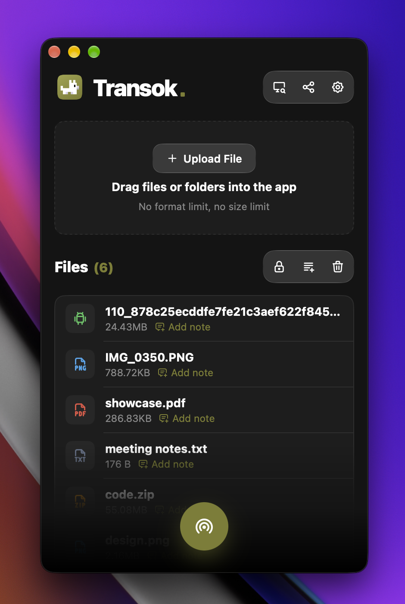
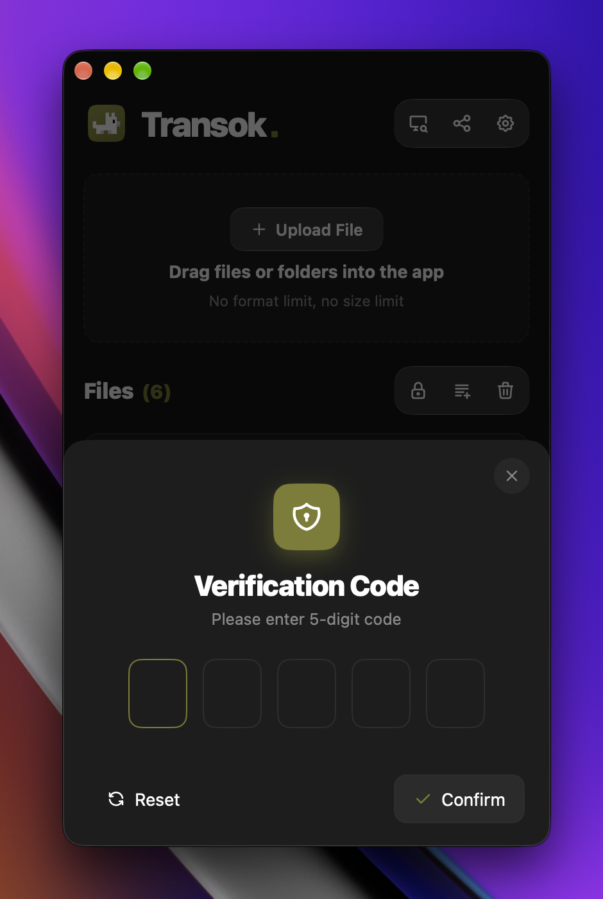
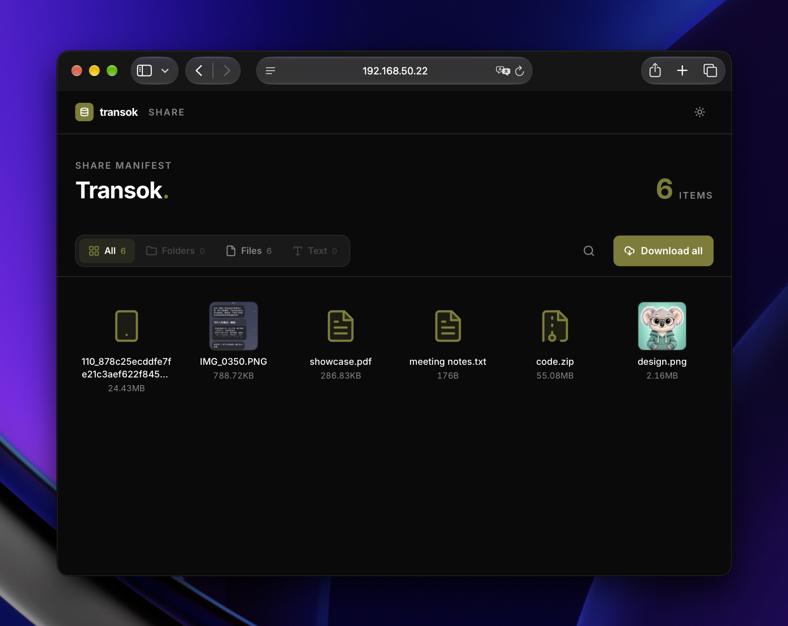

  

<h4 align="center"><a href="https://github.com/bent2685/transok/blob/main/README.md">English</a> | <strong>简体中文</strong></h4>

![go][go-badge]
![ts][ts-badge]
![license][license-badge]

 

> 一个高效的局域网文件共享工具

---

# 关于

**Transok** 是一个局域网文件共享小工具。它不会占用多余的存储空间，对传输文件数量和大小没有限制。同时分享文件时可以设置密码，防止文件被非法下载。

---

桌面客户端已使用 [MyGo](https://github.com/egoist/mygo) 原生 UI 重构（Go 绘制，无 WebView）。

---

# Preview

---

# 贡献者

感谢以下贡献者让这个项目变得更好：

- [@404errorg6](https://github.com/404errorg6) (Fahad Khan) —— 使用 `betamos/zeroconf` 重写了局域网设备发现服务（[#32](https://github.com/bent2685/transok/pull/32)，修复 [#6](https://github.com/bent2685/transok/issues/6)）

---

# Sponsor

☕ 如果这个项目对你有帮助，为什么不请我喝杯咖啡呢？这将激励我继续开发。

---

# License

[MIT](/LICENSE)

[go-badge]: https://img.shields.io/github/go-mod/go-version/bent2685/transok
[ts-badge]: https://badgen.net/badge/-/TypeScript/blue?icon=typescript&label
[license-badge]: https://img.shields.io/github/license/bent2685/transok
